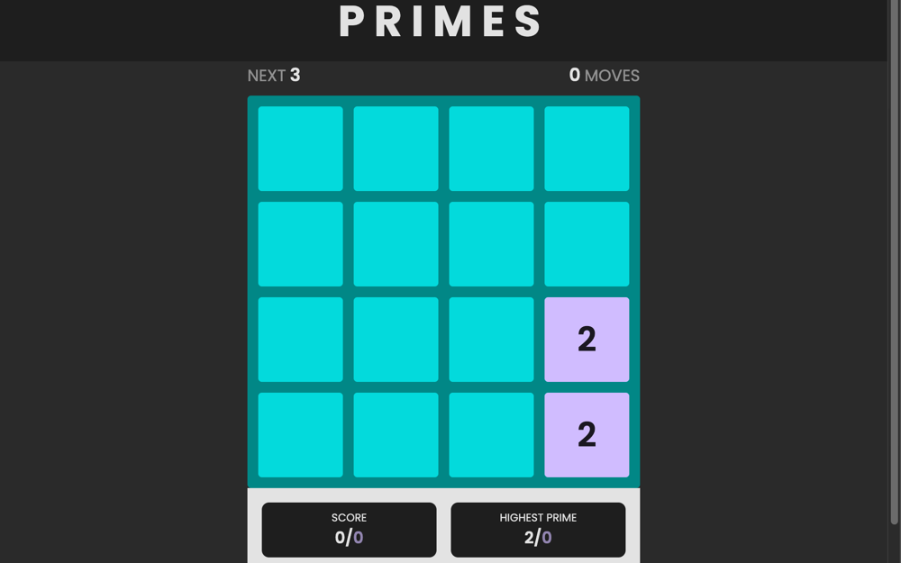
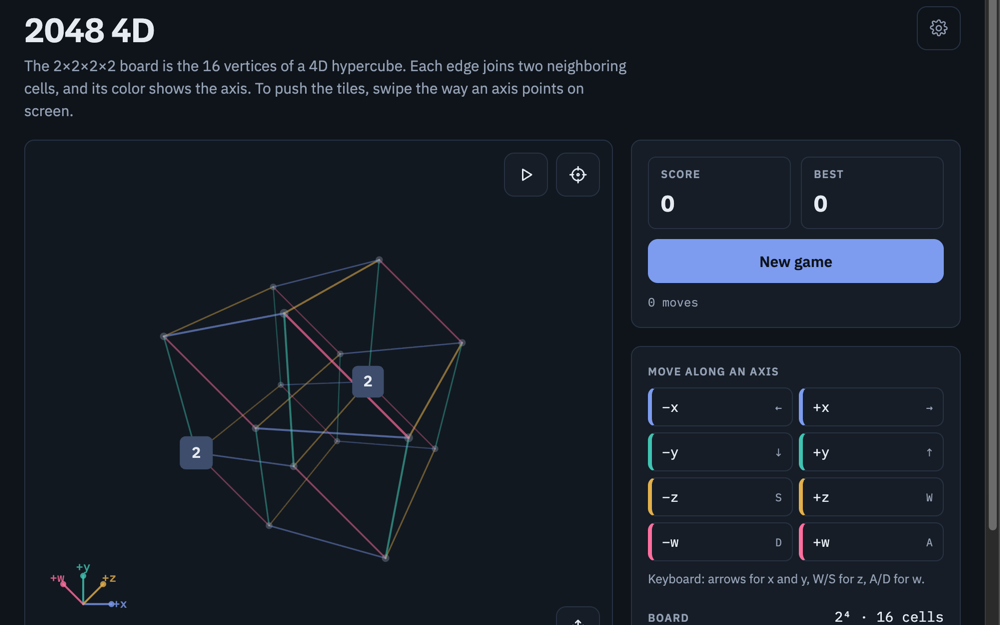
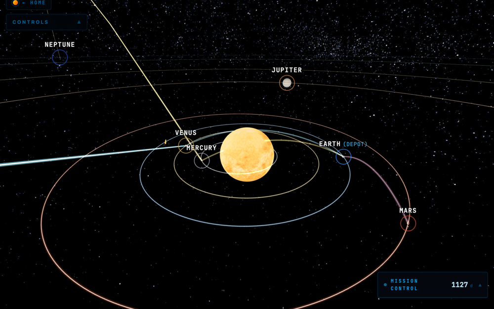
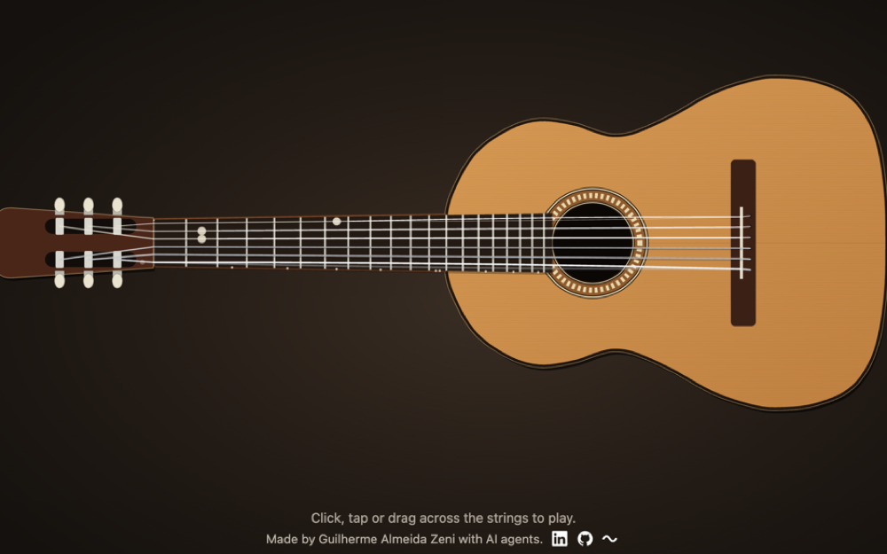
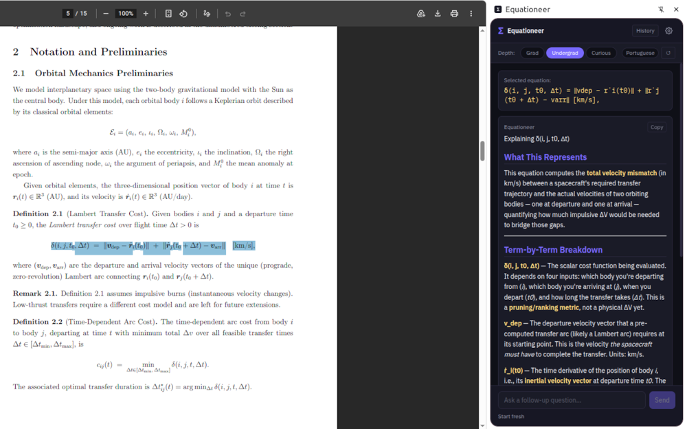
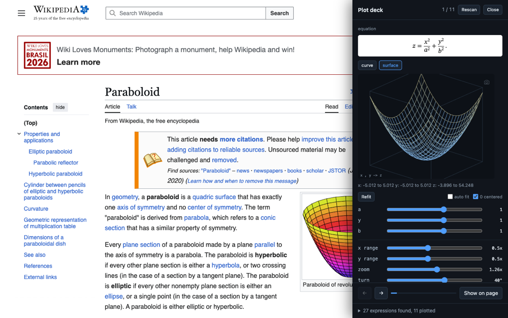

<picture>
  <source media="(prefers-color-scheme: dark)" srcset="assets/banner-dark.svg">
  <source media="(prefers-color-scheme: light)" srcset="assets/banner-light.svg">
  
</picture>

  
  
  
  
  
  

I'm a senior software engineer with more than ten years of production work across backend, web and platform systems, in multi-region delivery for clients mostly in North America. I hold a B.Tech in Systems Analysis and Development and an M.Sc. in Technology (Information and Communication Systems), both from Unicamp. My research is in combinatorial optimization: vehicle routing, scheduling, and decisions under constraints. On the side I build small products, mostly games and tools with mathematics at their core.

### Now

- **Applied mathematics at IMECC, Unicamp.** Exact methods for an integrated production-routing problem with product decay and appointment time windows.
- **[Zenus](https://github.com/Guillhermm/zenus).** An intent execution engine for Linux: natural language in, verified shell actions out, with rollback.

### Research

- **M.Sc. in Technology, Information and Communication Systems, Unicamp (2020).** A vehicle routing benchmark modeled on real post office deliveries in Artur Nogueira. [Dissertation](https://repositorio.unicamp.br/acervo/detalhe/1127172)
- **Book chapter, Elsevier (2019).** How to assess your smart delivery system? Benchmarks for rich vehicle routing problems. [Chapter](https://www.sciencedirect.com/science/article/abs/pii/B9780128157152000075)

### Projects

<table>
  <tr>
    <td width="50%" valign="top">
      
       <b><a href="https://github.com/Guillhermm/primes">Primes</a></b>
       A 2048-style puzzle game built on prime numbers.
       <a href="https://guillhermm.github.io/primes/">Play on the web</a> · <a href="https://play.google.com/store/apps/details?id=io.github.guillhermm.twa">Google Play</a>
    </td>
    <td width="50%" valign="top">
      
       <b><a href="https://github.com/Guillhermm/4d-2048">2048 4D</a></b>
       2048 on a real four-dimensional board: the 16 vertices of a tesseract.
       <a href="https://guillhermm.github.io/4d-2048/">Play on the web</a>
    </td>
  </tr>
  <tr>
    <td width="50%" valign="top">
      
       <b><a href="https://ivrp.zenus.systems">Interplanetary VRP</a></b> 🔒
       Vehicle routing as interplanetary mission scheduling, solved exactly.
       <a href="https://ivrp.zenus.systems/simulator">Simulator</a> · <a href="https://doi.org/10.5281/zenodo.19475128">Preprint</a>
    </td>
    <td width="50%" valign="top">
      
       <b><a href="https://github.com/Guillhermm/guitar-simulator">Guitar Simulator</a></b>
       A classical guitar you play in the browser, with a tablature editor.
       <a href="https://guillhermm.github.io/guitar-simulator/">Play on the web</a>
    </td>
  </tr>
  <tr>
    <td width="50%" valign="top">
      
       <b><a href="https://github.com/Guillhermm/equationeer">Equationeer</a></b>
       Chrome extension: highlight an equation on any page or PDF and get it explained.
       <a href="https://chromewebstore.google.com/detail/equationeer/ccgeiaeelfigohdkapghnpilecpmnedb">Chrome Web Store</a>
    </td>
    <td width="50%" valign="top">
      
       <b><a href="https://github.com/Guillhermm/plotdeck">Plot deck</a></b>
       Chrome extension: finds the equations on a page and plots them, with a slider per parameter.
       <a href="https://chromewebstore.google.com/detail/plot-deck/dfbabdkjmbgjkfmflhcfplnanonihaol">Chrome Web Store</a>
    </td>
  </tr>
</table>

### Toolkit

  
  
  
  
  
  
  

  
  
  
  
  
  
  

